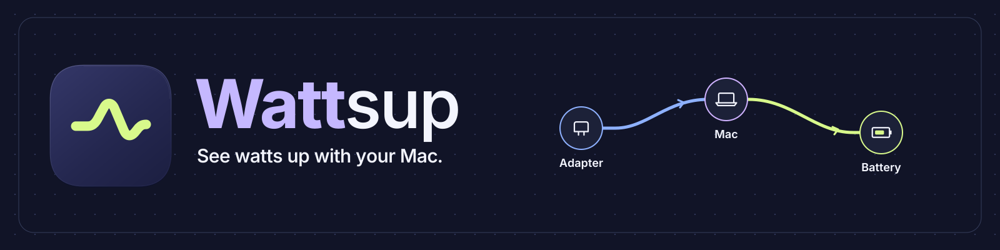

# Wattsup



Live power telemetry for your MacBook, in the menu bar. Watts, volts and amps at a glance, a
dashboard far deeper than the battery settings, and a charger check that tells you whether the
brick you plugged in is holding your Mac back.

Site: https://goriparthi.github.io/wattsup/

## What it shows

- **Menu bar**: pick any of 14 readings and order them, on one line or two rows, colored by meaning
  in an outlined capsule. Hover a number to see what it is.
- **Popover**: a battery tank that fills and drains, a hybrid car style power flow from charger to
  Mac to battery (and to any powered accessories), the charger verdict, and grouped details.
- **Dashboard**: history charts, every USB-C Power Delivery profile, charger efficiency, battery
  health, cycles and per cell voltages, energy mode, and every charger you have used.
- **Charger check**: tells you when the charger, or its cable, is the bottleneck and what size
  would fix it, and grades its efficiency.

Readings come from the `AppleSmartBattery` IOKit entry, read locally without admin rights. They
never leave the Mac: no account, no analytics. The only network request is a daily check of this
repo's releases for an update, which can be turned off in Settings.

## Docs

| Doc | For |
| --- | --- |
| [User guide](docs/USER-GUIDE.md) | What every reading and verdict means |
| [Architecture](docs/ARCHITECTURE.md) | Targets, data sources, how a reading flows, key decisions |
| [Logs and crash reports](docs/DIAGNOSTICS.md) | Where logs live and how to send a report |
| [Releasing](docs/RELEASING.md) | Shipping a notarized release |
| [Brand](brand/BRAND.md) | Palette, type, icon and glyph specs |

## Requirements

macOS 14 or later on an Apple silicon MacBook. Xcode for building and testing.

## Run it locally

```sh
make run        # debug build, opens the dashboard
make test       # unit tests
make install    # signed release build into ~/Applications, then launches it
.build/debug/wattsup --snapshot      # one reading as text
.build/debug/wattsup --diagnostics   # log folder, crash reports, recent log
```

`make ci` runs exactly what GitHub Actions runs.

## Layout

| Path | What lives there |
| --- | --- |
| `Sources/WattsupCore` | Pure parsing and analysis: registry parsing, units, history, charger verdicts, charger log. No IOKit or AppKit, fully unit tested. |
| `Sources/wattsup` | The app: IOKit reader, monitor, status item, popover, dashboard. |
| `Tests/WattsupCoreTests` | Tests built from registry readings captured on a real MacBook. |
| `scripts/` | Build, bundle, sign, install, CI. The Makefile only indexes these. |
| `site/` | The marketing page, deployed to GitHub Pages on push to `main`. |
| `brand/` | Brand kit: `BRAND.md` spec, logo and icon masters, boards. `Resources/Wattsup.icns` is built from it. |

## Why the numbers can be trusted

The charger verdict uses only measured values: the active Power Delivery profile is the
ceiling, the battery's own requested voltage and current give the demand. Reason codes for slow
or paused charging are shown raw because Apple does not document them.

## Debugging aids

`wattsup --popover`, `--settings` and `--dashboard` open that view at launch, and
`wattsup --render-menubar <dir>` draws every menu bar style to PNGs from a live reading.

## License

MIT
